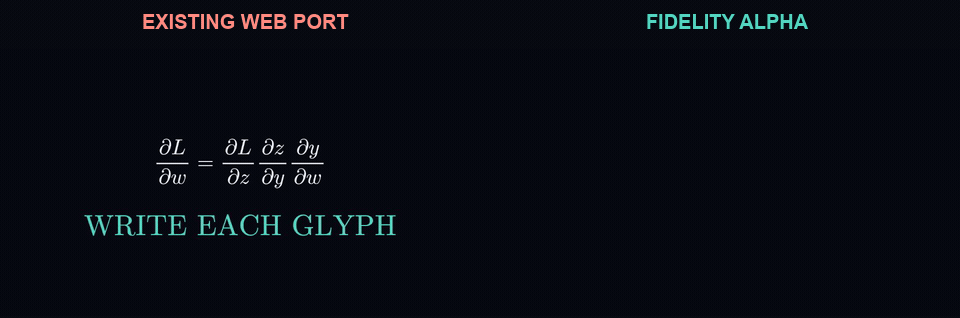

<div align="center">

# manim-web fidelity alpha

**Manim-style mathematical animation in TypeScript, rendered directly in the browser.**

</div>

> [!WARNING]
> **Experimental alpha.** APIs, rendering behavior, and export output may change. This is a fidelity-focused fork of [`manim-web`](https://github.com/maloyan/manim-web), not a drop-in replacement for Python Manim and not yet intended for production-critical rendering. Inspect and validate exported media.

<div align="center">



<sub>The same deterministic <code>Write(MathTex)</code> scene on upstream 0.3.24 and this alpha. The upstream implementation exposes the completed glyphs immediately; this branch traces and fills their vector paths over time.</sub>

</div>

## What this is

This repository is a browser-native TypeScript toolkit for building Manim-style mathematical animations as HTML scenes. It is especially useful for coding agents and web applications that need inspectable scene code, deterministic seeking, and GIF or MP4 output without a Python runtime.

This alpha focuses on fidelity gaps that become obvious in real productions:

- progressive path-based `Write` and `Create` animations;
- fill-aware fades, transforms, indications, arrows, and graph drawing;
- deterministic timeline recording, seeking, and frame export;
- MathTex, geometry, graphing, 3D, React, and Vue building blocks; and
- a 12,201-frame ESAP review scene used as a full-production regression case.

It does not yet promise complete API or pixel parity with Python Manim.

## Quick start

```bash
git clone https://github.com/Michaelihc/manim-web-fidelity-alpha.git
cd manim-web-fidelity-alpha
npm install
npm run dev
```

Then open one of the pages under `examples/`, such as:

- `http://localhost:5173/examples/write_limit_demo.html`
- `http://localhost:5173/examples/esap_review.html`

The ESAP page runs visually without bundled audio. Supply audio you have the right to use with an `audio` query parameter, for example `?audio=/media/track.wav`.

## Small example

```typescript
import { Circle, Create, FadeOut, Scene, Square, Transform } from './src/index.ts';

const scene = new Scene(document.getElementById('stage')!, {
  width: 800,
  height: 450,
});

const square = new Square({ sideLength: 3 });
const circle = new Circle({ radius: 1.5 });

await scene.play(new Create(square));
await scene.play(new Transform(square, circle));
await scene.play(new FadeOut(square));
```

## Capabilities

- **Geometry** — circles, rectangles, polygons, arrows, arcs, braces, and more
- **Text and math** — vector text, MathTex, Tex, and paragraphs
- **Graphing** — axes, number planes, functions, vector fields, and charts
- **3D** — surfaces, solids, three-dimensional axes, and orbit controls
- **Animation** — creation, fading, transforms, indications, groups, and staggered starts
- **Interaction** — draggable, hoverable, and clickable mobjects
- **Export** — GIF, browser video, and deterministic MP4 rendering workflows
- **Frameworks** — React and Vue scene components

## Validation

```bash
npm run typecheck
npm test
npm run test:integration
```

The included fidelity fixtures expose deterministic intermediate animation states so automated tests and agents can inspect partial geometry instead of judging only the final frame.

## Project status and provenance

This is an experimental derivative of [Narek Maloyan's `manim-web`](https://github.com/maloyan/manim-web). The original MIT license and copyright notice are preserved. The project is inspired by [3Blue1Brown's Manim](https://github.com/3b1b/manim) but is an independent TypeScript implementation.

Generated renders, QA captures, reference videos, and third-party audio are intentionally excluded from the repository.

## License

[MIT](LICENSE)
